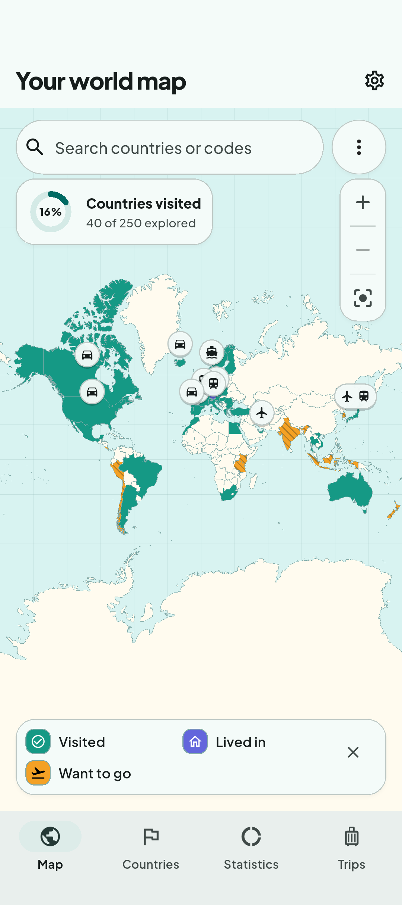
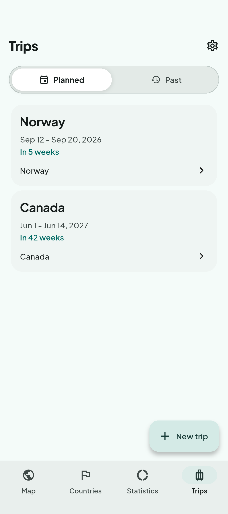
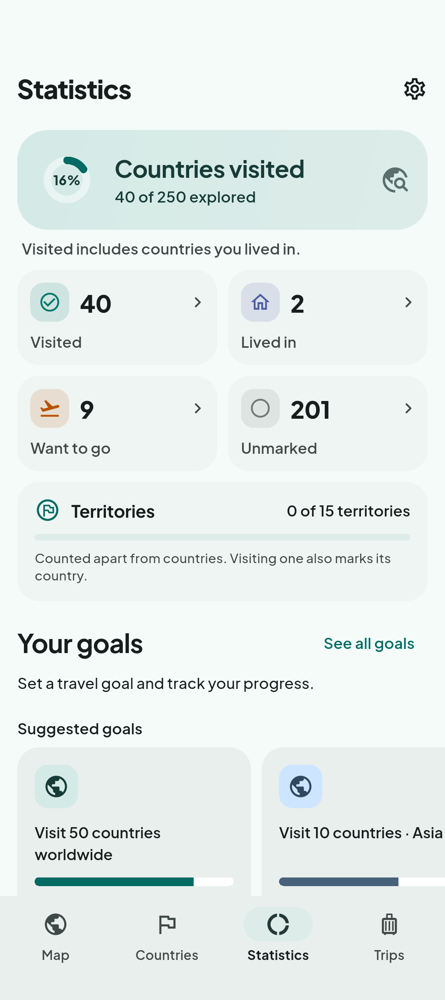

  

<h1 align="center">Worldpath</h1>

Your trips. Your memories. Your world map.

  <a href="https://mschudt.github.io/worldpath-website/">Website</a> ·
  <a href="https://play.google.com/store/apps/details?id=de.app.worldpath">Google Play</a> ·
  <a href="https://mschudt.github.io/worldpath-website/privacy/">Privacy policy</a>

Worldpath brings your travel history and your next adventures together on a
personal world map. Mark countries, cities, and selected territories as visited,
lived in, or want to go; keep planned and past trips in one place; and explore
your progress with statistics, goals, collections, and a timeline.

  
  
  

*Actual app screens with fictional travel data.*

- **Ready offline.** Core features work without an internet connection.
- **Simple to start.** No account or location permission required.
- **Made for your journeys.** Track places, trip stops, dates, and transport.
- **Room to look back.** Explore regional progress and save local backups.
- **English and German.** Available in both languages from the start.

Travel records are stored on your device. Usage analytics is enabled by default
and can be switched off in Settings; it can include selected travel content and
search terms. See the [privacy policy](https://mschudt.github.io/worldpath-website/privacy/)
for details.

This repository is the public home of the Worldpath website and privacy policy.

Questions or feedback? [movi.apps.dev@gmail.com](mailto:movi.apps.dev@gmail.com)
